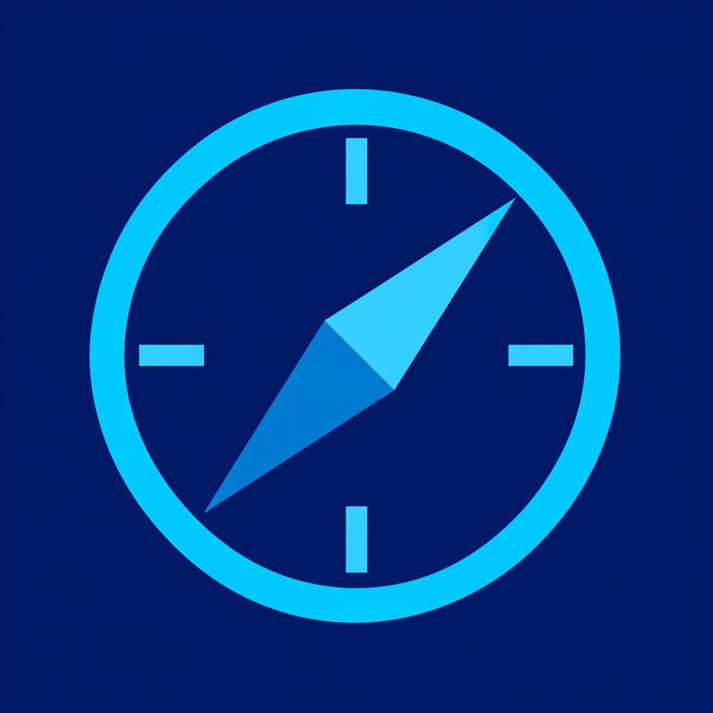
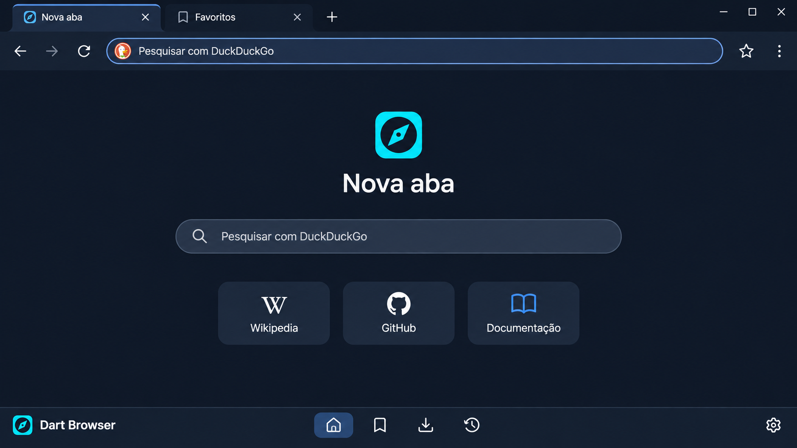
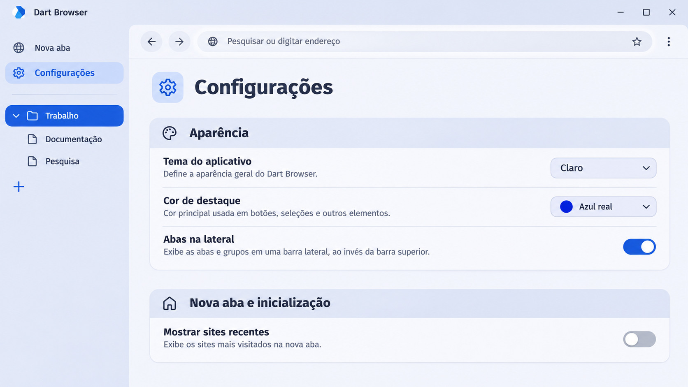
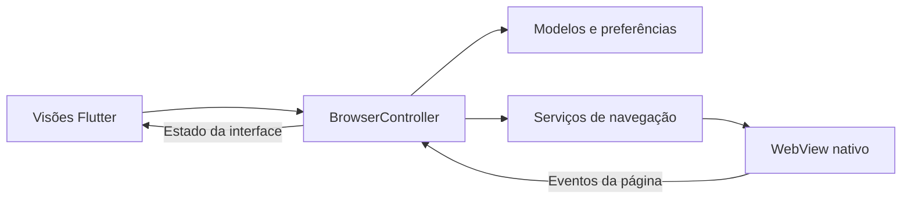

<div align="center">
  
  <h1>Dart Browser</h1>
  <p>Navegador nativo em Flutter e Dart com grupos de abas, ferramentas de leitura e uma interface personalizável.</p>
  <p><strong>Windows · Linux · macOS · Android · iOS</strong></p>
  <p>
    <a href="#primeira-abertura">Começar</a> ·
    <a href="#prévias-da-interface">Prévias</a> ·
    <a href="#mapa-da-interface">Interface</a> ·
    <a href="#configurações">Configurações</a> ·
    <a href="#privacidade-e-dados">Privacidade</a> ·
    <a href="#atalhos">Atalhos</a> ·
    <a href="#build-e-distribuição">Builds</a>
  </p>
</div>

---

## Visão geral

| Se você quer… | Comece aqui |
| --- | --- |
| Instalar uma versão ou gerar um pacote | [Build e distribuição](#build-e-distribuição) |
| Escolher o buscador e começar a navegar | [Primeira abertura](#primeira-abertura) |
| Organizar abas e guardar páginas | [Uso diário](#uso-diário) |
| Importar um complemento | [Extensões e scripts](#extensões-e-scripts) |
| Rodar o projeto a partir do código | [Desenvolvimento](#desenvolvimento) |

## Prévias da interface

Imagens simuladas para ilustrar os recursos. A disposição e os detalhes podem variar no aplicativo.

### Nova aba em tema escuro



### Configurações e abas laterais em tema claro



## Mapa da interface

O esquema mostra a disposição com abas no topo. No modo vertical, a barra de abas passa para uma das laterais e a barra de endereço permanece acima da página.

~~~text
┌─────────────────────────────────────────────────────────┐
│ Abas          Grupo de abas ▾          Aba ativa     +  │
├─────────────────────────────────────────────────────────┤
│ ←  →  ↻      Pesquisar ou digitar um endereço      ☆  ⋮ │
├─────────────────────────────────────────────────────────┤
│                                                         │
│                Site aberto ou tela de nova aba          │
│                                                         │
└─────────────────────────────────────────────────────────┘
~~~

| Região da interface | Controles disponíveis |
| --- | --- |
| **Barra de abas** | Abrir e selecionar abas, fixar páginas e organizar grupos recolhíveis. A barra pode ficar no topo ou nas laterais. |
| **Barra de endereço** | Abrir endereços, pesquisar, voltar, avançar, recarregar, interromper o carregamento e acessar favoritos e extensões fixadas. |
| **Área da página** | Exibe o site ativo, a tela de nova aba ou uma ação para tentar novamente quando o carregamento falha. |
| **Nova aba** | Busca central, atalhos para favoritos, página inicial e sites recentes. |
| **Menu** | Biblioteca, guias anônimas, ferramentas de página, extensões e configurações. |
| **Dock de ferramentas** | Acesso à paleta de comandos, captura, leitura em voz alta, tradução e escudo de privacidade. |

## Primeira abertura

1. Escolha o buscador, o tema e a posição das abas na tela de boas-vindas.
2. Selecione **Começar a navegar**. O navegador registra a conclusão no perfil local.
3. Digite um endereço na barra superior ou faça uma busca pela nova aba.

Os buscadores disponíveis são **Google, DuckDuckGo, Bing, Ecosia, Brave Search e Yahoo**. Altere o padrão em **Configurações → Navegação → Mecanismo de busca** ou pelo seletor na nova aba. A escolha vale para as duas barras de busca.

## Uso diário

### Abas e sessões

- Abra o menu **Organizar aba** (⋯) para criar um grupo com nome e cor, mover a aba para outro grupo ou retirá-la. Clique no cabeçalho de um grupo para recolhê-lo ou expandi-lo.
- O menu do grupo permite editar nome e cor, criar uma aba no grupo ou desagrupar as páginas abertas.
- Use **Abas na lateral** para trocar de layout. Nas configurações, posicione a barra à esquerda ou à direita e ative o modo compacto para mostrar apenas os ícones.
- O menu oferece ações para duplicar, reabrir, fixar e silenciar abas. A restauração de sessão recupera os endereços das abas comuns, os grupos e a seleção.
- O economizador de memória suspende abas inativas. Selecionar uma aba suspensa recarrega a página.

### Favoritos, histórico e leitura

- Use a estrela para favoritar a página atual. **Favoritar abas abertas** salva em lote os endereços HTTP/HTTPS das abas comuns, sem duplicar entradas.
- Abra **Favoritos**, **Histórico** ou **Lista de leitura** pelo menu. Favoritos e histórico podem ser filtrados por endereço. Na lista de leitura, marque itens que já foram lidos.
- Use **Localizar na página** para percorrer ocorrências de um termo. Ajuste o zoom ou abra o **Modo leitura** para tentar extrair o conteúdo principal de um artigo.
- Guias anônimas ficam fora do histórico e da restauração de sessão do aplicativo. O isolamento de cookies e dados de sites depende do motor e da integração de perfil.

### Encontrar e retomar uma página

| Quando | Onde procurar |
| --- | --- |
| Você já visitou a página | Abra **Menu → Histórico** e filtre pelo endereço. |
| Você usa o site com frequência | Adicione aos **Favoritos** pela estrela da barra de endereço. |
| Você quer guardar um artigo para depois | Adicione à **Lista de leitura** e marque como lido ao terminar. |
| Você acabou de fechar a aba | Use **Reabrir aba fechada** ou **Ctrl+Shift+T**. |

### Ferramentas e vídeo

- Consulte as informações do site, copie ou compartilhe o endereço por QR Code, veja o código-fonte ou ajuste o agente de usuário pelo menu.
- Em vídeos HTML5 compatíveis, o botão **PiP** aparece na página. A disponibilidade depende do vídeo, do motor e das políticas do site.
- No Android 8 ou superior, **Janela flutuante no Android** minimiza a atividade inteira em dispositivos compatíveis. Abra o vídeo em tela cheia antes para aproveitar a área da janela.

### Ferramentas de produtividade

| Ferramenta | Como usar |
| --- | --- |
| **Paleta de comandos** | Pressione **Ctrl+K** para buscar ações do navegador pelo nome. |
| **Captura da página** | Abra o dock ou pressione **Ctrl+Shift+S** para gerar uma prévia e salvar a imagem. |
| **Leitura em voz alta** | Use o dock ou **Ctrl+Shift+U**. A reprodução usa as vozes de síntese disponíveis no motor. |
| **Tradução** | Use **Traduzir página para português**. A função usa o Google Tradutor e pode abrir a página traduzida por esse serviço. |
| **Notas por site** | Use o menu de contexto para escrever notas vinculadas ao site. O texto é salvo localmente. |
| **Prévia de link** | Use a opção de prévia no menu de contexto para consultar o destino antes de abrir uma aba. |
| **Sons de foco** | Abra o controle no dock. A reprodução depende do suporte do motor a áudio na página. |
| **Tela cheia** | Pressione **F11** ou use o controle de tela cheia quando disponível no sistema. |

### Downloads e transferência de favoritos

A **Central de Downloads**, em **Configurações**, mostra os downloads registrados pelo navegador, com nome, origem e localização quando disponível. A opção de limpar a lista remove os registros.

Em **Configurações → Favoritos (Importar / Exportar HTML)**, transfira endereços no formato de favoritos HTML. A importação adiciona links HTTP/HTTPS e ignora endereços que já estão salvos. A exportação gera uma lista dos favoritos do navegador.

## Configurações

Abra **Menu → Configurações**.

| Seção | Opções |
| --- | --- |
| **Navegação** | Buscador padrão, endereço da página inicial e restauração de abas. |
| **Desempenho** | Economizador de memória para abas inativas. |
| **Modo leitura e mídia** | Tema e tamanho da fonte do leitor. Opção de Picture-in-Picture automático. |
| **Aparência** | Tema do sistema, claro ou escuro. Cor de destaque, preto OLED, arredondamento, filtro escuro para sites e posição da barra de abas. |
| **Nova aba e inicialização** | Exibir atalhos e sites recentes separadamente. Abrir a página inicial quando nenhuma sessão for restaurada. |
| **Motor de navegação** | Identificação do motor, diagnóstico da página e escolha do runtime WebView2 no Windows. |
| **Complementos** | Gerenciamento de extensões e scripts. |
| **Privacidade e dados** | Proteções de navegação, exceções por site, controle do histórico e limpeza de dados. |

## Privacidade e dados

### Escudo de navegação

Em **Configurações**, ajuste separadamente o bloqueador de anúncios, o anti-rastreio, a proteção anti-fingerprint e a limpeza de parâmetros de URL. Use **Sites permitidos** para cadastrar exceções e **Estatísticas de proteção** para consultar os contadores. O botão de escudo no dock mostra os dados da aba ativa.

Esses controles usam regras e scripts do navegador. A cobertura depende do tipo de solicitação, do site e do motor nativo. Se uma página parar de funcionar como esperado, teste a exceção por site e recarregue.

### Dados locais e sessão

| Dado | Como é usado |
| --- | --- |
| **Preferências** | O navegador guarda buscador, aparência e opções da nova aba no perfil local. |
| **Biblioteca e notas** | Favoritos, lista de leitura e notas permanecem no perfil do aplicativo. |
| **Histórico** | Ao desativar o registro, as próximas visitas deixam de entrar no histórico. Use **Limpar histórico** para apagar as entradas existentes. |
| **Sessão** | Quando habilitada, a restauração guarda as abas comuns e seus grupos. A opção de abrir a página inicial se aplica quando não há sessão a restaurar. |
| **Cookies e cache** | Os dados do motor podem ser limpos separadamente. Limpar cookies pode encerrar sessões em sites. |

## Extensões e scripts

Abra **Menu → Extensões do Chrome**. Para importar uma extensão, indique uma pasta descompactada acessível ao aplicativo que contenha `manifest.json` e os arquivos referenciados por ele. Ative a extensão e recarregue a página.

| Recurso | Cobertura atual |
| --- | --- |
| **Manifestos V2 e V3** | Importação de extensões descompactadas com recursos compatíveis. |
| **Scripts e estilos** | Injeção de JavaScript e CSS nas páginas que correspondem aos padrões de URL da extensão. |
| **Interface** | Pop-ups compatíveis, fixação na barra e badges. |
| **APIs** | Emulação parcial de `runtime`, `storage`, `tabs` e `action`. O comportamento depende do motor e da extensão. |

O gerenciador também oferece modo do desenvolvedor, edição de código e opções de exportar e restaurar backup dos complementos. Use essas opções para revisar ou transferir as configurações de extensões locais.

A instalação direta pela Chrome Web Store, pacotes `.crx`, service workers completos e a equivalência integral das APIs Chrome ficam fora da cobertura atual.

## Atalhos

No macOS, use **⌘** no lugar de **Ctrl**. Os atalhos podem depender do foco na interface do navegador.

| Atalho | Ação | Atalho | Ação |
| --- | --- | --- | --- |
| `Ctrl+L` | Selecionar o endereço | `Ctrl+E` | Limpar e focar a barra para pesquisar |
| `Ctrl+T` | Abrir aba | `Ctrl+Shift+T` | Reabrir aba fechada |
| `Ctrl+W` | Fechar a aba atual | `Ctrl+Shift+N` | Abrir guia anônima |
| `Ctrl+R` ou `F5` | Recarregar | `Ctrl+F` | Localizar na página |
| `Ctrl+D` | Alternar favorito | `Ctrl+H` | Abrir histórico |
| `Ctrl+U` | Ver código-fonte | `Ctrl+M` | Alternar o som da aba |
| `Ctrl+Shift+P` | Fixar ou desafixar aba | `Esc` | Fechar a busca na página |
| `Ctrl+=` / `Ctrl+-` | Aumentar ou reduzir zoom | `Ctrl+0` | Restaurar zoom |

| Atalho adicional | Ação |
| --- | --- |
| `Ctrl+K` | Abrir a paleta de comandos |
| `Ctrl+Shift+S` | Capturar a página |
| `Ctrl+Shift+U` | Alternar leitura em voz alta |
| `F11` | Alternar tela cheia |

## Plataformas e motores

| Plataforma | Motor | Requisitos |
| --- | --- | --- |
| **Windows** | Microsoft Edge WebView2 | Windows 10 1809 ou superior e WebView2 Runtime. Para compilar, Visual Studio com ferramentas C++ e suporte a links simbólicos. |
| **Linux** | WebKitGTK | GTK 3 e WebKitGTK 4.1. O pacote do workflow é compilado no Ubuntu 24.04 x64. |
| **macOS** | WKWebView | macOS 12 ou superior. Para compilar, Xcode. |
| **Android** | Android System WebView | API 24 ou superior no dispositivo. Para compilar, JDK 17 e Android SDK 36 ou superior. |
| **iOS** | WKWebView | iOS 15 ou superior. Para compilar, Xcode no macOS. |

No Windows, em **Configurações → Motor de navegação → Escolher runtime do WebView2**, selecione o **Evergreen** do sistema ou uma pasta **Fixed Version** extraída. Reinicie o aplicativo para aplicar. A tela de inicialização oferece retorno ao Evergreen se o runtime fixo falhar.

Use **Verificar compatibilidade da página** para consultar a presença de WebGPU, WebCodecs, WebAuthn, WebRTC e recursos CSS. O diagnóstico vale para a página atual. A execução depende também de permissões, hardware e políticas do site.

## Desenvolvimento

O [workflow](.github/workflows/main.yml) usa **Flutter 3.47.9**. O projeto exige **Dart 3.13.7 ou superior na série 3.x**.

```sh
flutter doctor -v
flutter pub get
flutter devices
flutter run -d <id-do-dispositivo>
```

Use `windows`, `linux` ou `macos` para um destino desktop disponível. No Android e iOS, selecione um ID listado por `flutter devices`.

No Ubuntu 24.04, instale as dependências nativas do workflow:

```sh
sudo apt-get update
sudo apt-get install -y clang cmake ninja-build pkg-config libgtk-3-dev \
  liblzma-dev libwebkit2gtk-4.1-dev
```

Para verificar o código Dart, execute `dart analyze lib`.

### Arquitetura MVC



| Caminho | Responsabilidade |
| --- | --- |
| [`lib/main.dart`](lib/main.dart) | Inicialização, tema e verificação do motor. |
| [`lib/models/`](lib/models/) | Abas, grupos, buscadores, lista de leitura e extensões. |
| [`lib/controllers/browser_controller.dart`](lib/controllers/browser_controller.dart) | Sessão, navegação, comandos da interface e coordenação dos serviços. |
| [`lib/services/`](lib/services/) | Motor, extensões, proteção de navegação, tradução, leitura em voz alta, busca na página e PiP. |
| [`lib/views/`](lib/views/) | Tela principal, boas-vindas, configurações e componentes. |

## Build e distribuição

### Instalar um artefato

- **Windows** — execute o instalador e confirme que o WebView2 Runtime está disponível.
- **Linux** — no Ubuntu 24.04 x64, instale o pacote com `sudo apt install ./dart-browser-linux.deb`.
- **macOS** — abra a imagem DMG e copie o aplicativo para **Aplicativos**.
- **Android** — abra o APK no dispositivo e siga a confirmação de instalação do sistema.
- **iOS** — assine o pacote e configure o provisionamento antes de instalar em um dispositivo.

### Build local

| Plataforma | Comando | Saída |
| --- | --- | --- |
| Android | `flutter build apk --release` | `build/app/outputs/flutter-apk/app-release.apk` |
| Windows | `flutter build windows --release` | `build/windows/x64/runner/Release/` |
| Linux | `flutter build linux --release` | `build/linux/x64/release/bundle/` |
| macOS | `flutter build macos --release` | `build/macos/Build/Products/Release/dart_browser.app` |
| iOS | `flutter build ios --release --no-codesign` | `build/ios/iphoneos/Runner.app` |

### GitHub Actions

O workflow [Build & Release Dart Browser](.github/workflows/main.yml) compila os cinco destinos em pull requests, no envio de tags `v*` e por execução manual na aba **Actions**.

| Gatilho | Resultado |
| --- | --- |
| Pull request | Compila os destinos e guarda os pacotes como artefatos da execução. |
| Envio de tag `v*` | Publica os pacotes em **GitHub Releases** com a tag enviada, após os cinco builds passarem. |
| Execução manual | Publica após os builds. O campo opcional **tag** define a versão da release. Se ficar vazio, o workflow usa a versão do `pubspec.yaml`. |

| Plataforma | Artefato |
| --- | --- |
| Android | `dart-browser-android.apk` |
| Linux | `dart-browser-linux.deb` |
| Windows | `DartBrowser-Setup.exe` |
| macOS | `dart-browser-macos.dmg` |
| iOS | `dart-browser-ios-unsigned.ipa` |

O IPA precisa de assinatura e provisionamento Apple para instalação em dispositivo físico. O instalador do Windows depende de um WebView2 Runtime disponível no computador.

## Solução de problemas

| Sintoma | O que verificar |
| --- | --- |
| **WebView2 indisponível** | Instale o runtime Evergreen ou corrija a pasta Fixed Version e reabra o navegador. |
| **Flutter pede links simbólicos no Windows** | Habilite o Modo de Desenvolvedor do Windows e execute `flutter pub get` novamente. |
| **Build Linux falha ao procurar WebKitGTK** | Confira se `pkg-config --modversion webkit2gtk-4.1` encontra a biblioteca de desenvolvimento. |
| **Extensão não atua na página** | Confira se está ativa, se o endereço corresponde ao manifesto e se a extensão exige APIs fora da cobertura atual. Recarregue a página. |
| **Botão PiP não aparece** | Confira se o vídeo HTML5, o motor e as políticas do site permitem Picture-in-Picture. |
