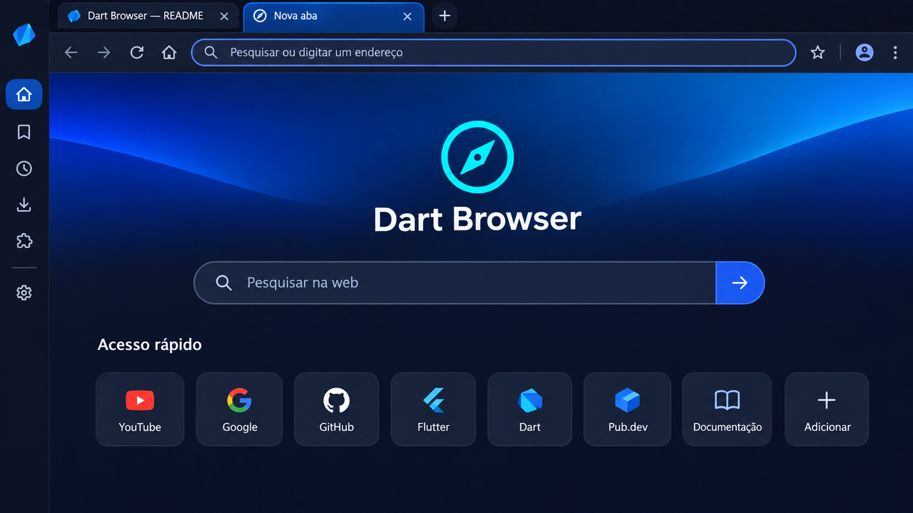
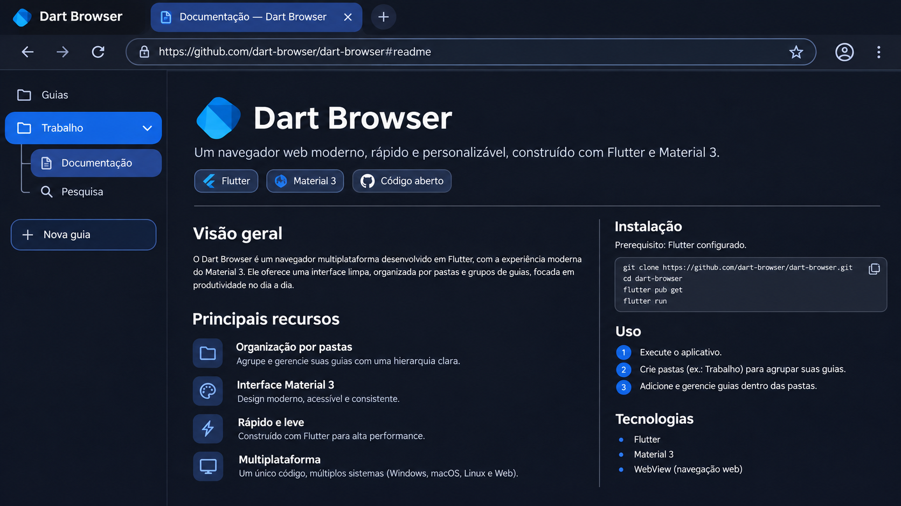
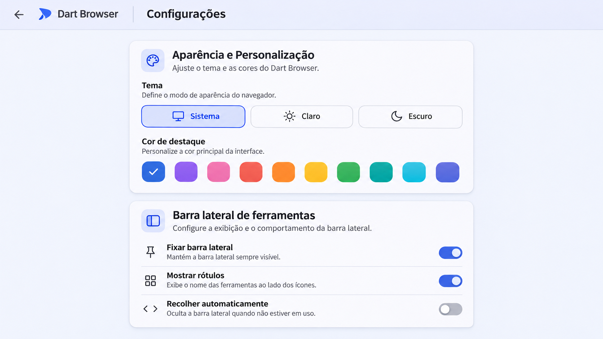
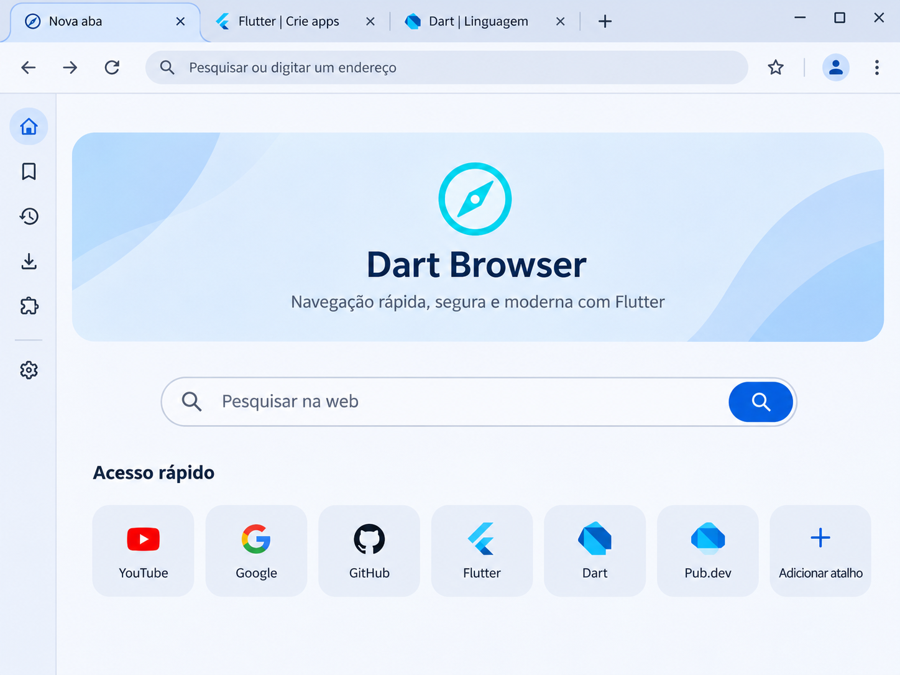
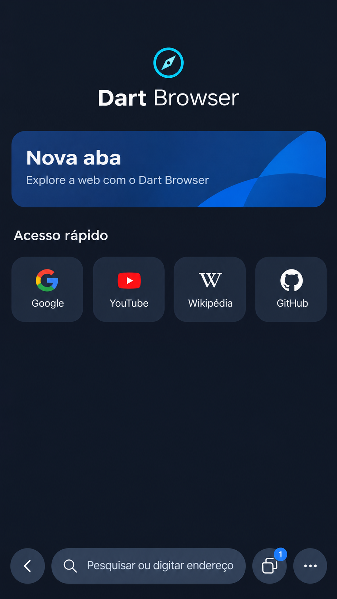
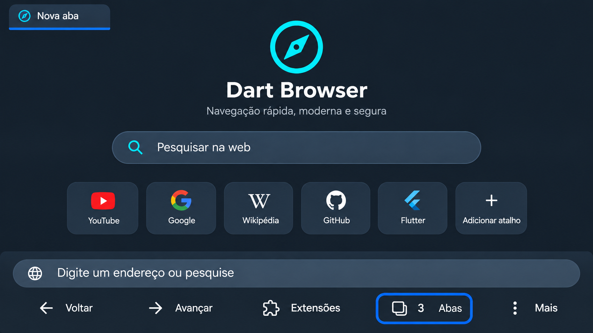
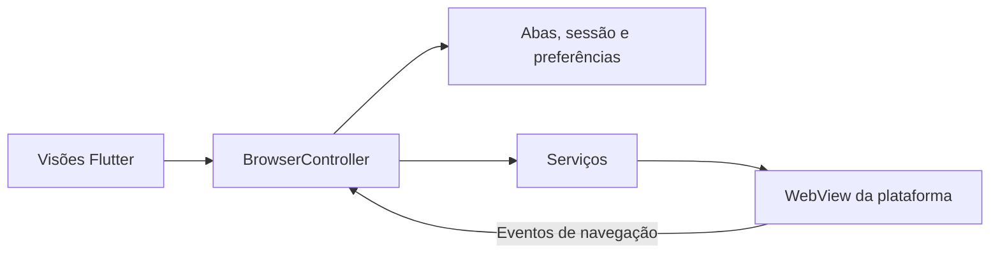

<div align="center">
  
  <h1>Dart Browser</h1>
  <p>Navegador em Flutter e Dart com grupos de abas, ferramentas de leitura e interface personalizável.</p>
  <p><a href="#instalação">Instalação</a> · <a href="#como-usar">Como usar</a> · <a href="#configurações">Configurações</a> · <a href="#desenvolvimento">Desenvolvimento</a></p>
</div>

## Prévias

*Simulações da interface. A aparência pode variar conforme a plataforma e o tema.*

| Desktop · Nova aba | Desktop · Grupos de abas |
| --- | --- |
|  |  |

| Desktop · Configurações | Tablet · Layout de desktop |
| --- | --- |
|  |  |

| Celular · Navegação no rodapé | Android TV e Google TV |
| --- | --- |
|  |  |

## Instalação

Baixe o pacote correspondente à sua plataforma em [GitHub Releases](https://github.com/aldobarduconeto/DartBrowser/releases).

| Plataforma | Pacote | Requisitos e instalação |
| --- | --- | --- |
| Windows | `DartBrowser-Setup.exe` | Windows 10 1809 ou superior, com Microsoft Edge WebView2 Runtime. Execute o instalador. |
| Linux | `dart-browser-linux.deb` | Pacote para Ubuntu 24.04 x64, com GTK 3 e WebKitGTK 4.1. Use `sudo apt install ./dart-browser-linux.deb`. |
| macOS | `dart-browser-macos.dmg` | macOS 12 ou superior. Abra o DMG e copie o aplicativo para **Aplicativos**. |
| Android | `dart-browser-android.apk` | Android API 24 ou superior, com Android System WebView. Abra o APK no dispositivo. |
| Android TV e Google TV | `dart-browser-android.apk` | O mesmo APK inclui uma entrada no lançador de TV e detecta o modo televisão. |
| iOS | `dart-browser-ios-unsigned.ipa` | iOS 15 ou superior. O pacote precisa de assinatura e provisionamento Apple para instalação em dispositivo. |

O projeto distribui aplicativos nativos. A versão para Apple TV (tvOS) ainda está pendente.

## Como usar

Na primeira abertura, o **guia de boas-vindas** apresenta os recursos do navegador. Escolha idioma, tema, buscador e posição das abas, depois selecione **Começar a navegar**. Para rever o guia, abra **Configurações → Produtividade e Atalhos**.

A barra de endereço abre URLs diretamente e envia termos ao buscador escolhido. As opções são Google, DuckDuckGo, Bing, Ecosia, Brave Search e Yahoo. Altere a preferência em **Configurações → Navegação** ou pelo seletor da nova aba.

### Interface por dispositivo

| Dispositivo | Navegação |
| --- | --- |
| **Desktop** | Abas no topo ou nas laterais. A barra de ferramentas pode ser ocultada por inteiro ou por atalho. |
| **Celular** | Endereço e navegação no rodapé. Toque no contador de abas para criar, alternar ou fechar abas. |
| **TV** | Barra de endereço com texto ampliado e foco inicial no seletor de abas para uso com o controle remoto. |

### Abas e grupos

No desktop, arraste uma aba com o mouse ou pressione e arraste com toque. Solte na primeira ou na segunda metade de outra aba para posicioná-la antes ou depois. Solte no cabeçalho de um grupo para adicioná-la a ele. A área de soltura no fim da barra retira a aba do grupo e a move para o final. O menu **Organizar aba** também permite mover abas entre grupos.

Os grupos podem ter nome, cor e estado recolhido. Você pode duplicar, fixar, silenciar e reabrir abas pelo menu. Quando a restauração de sessão está ativa, o navegador recupera a ordem, os grupos e a aba selecionada. Na restauração, o WebView das abas em segundo plano é criado sob demanda. O economizador de memória pode suspender abas inativas.

### Biblioteca, leitura e ferramentas

| Área | Recursos |
| --- | --- |
| **Favoritos** | Use a estrela para salvar a página ou **Favoritar abas abertas** para salvar abas comuns em lote. Importação e exportação usam HTML de favoritos. |
| **Histórico e leitura** | Filtre visitas por endereço, guarde páginas na lista de leitura e marque itens como lidos. |
| **Leitura e mídia** | Busca na página, zoom, modo leitura, leitura em voz alta, tradução para português e sons de foco. Vozes e mídia dependem do motor. A tradução usa o Google Tradutor. |
| **Picture-in-Picture** | Em vídeos HTML5 compatíveis, use o botão **PiP** da página. No Android compatível, a opção de janela flutuante minimiza a atividade inteira. |
| **Ferramentas da página** | Paleta de comandos, captura, notas por site, prévia de link, código-fonte, QR Code e seleção de agente de usuário. |
| **Downloads** | Consulte os downloads registrados em **Central de Downloads**. Limpar a lista remove os registros. |

## Configurações

| Seção | Opções |
| --- | --- |
| **Navegação** | Buscador e endereço da página inicial. |
| **Aparência** | Tema Sistema, Claro, Escuro ou OLED, cor de destaque, arredondamento, filtro escuro para sites e posição das abas. |
| **Barra lateral de ferramentas** | Oculte a barra inteira ou selecione quais atalhos aparecem no desktop. As abas verticais têm seu próprio controle. |
| **Nova aba e inicialização** | Escolha nova aba, sessão anterior, página inicial ou uma lista de endereços. Controle também a exibição de favoritos e sites recentes. |
| **Desempenho, leitura e mídia** | Economizador de memória, tema e fonte do leitor e PiP automático. |
| **Idioma** | Escolha o idioma do aplicativo ou siga o sistema. Inglês e espanhol têm tradução parcial dos textos próprios. Outros idiomas dependem dos componentes localizados do Flutter. |

### Privacidade e dados

O escudo oferece bloqueio de anúncios, anti-rastreio, proteção anti-fingerprint, limpeza de parâmetros de URL e exceções por site. A cobertura varia conforme o motor e a página. Use as estatísticas do escudo para consultar os contadores.

Favoritos, notas, lista de leitura e preferências ficam no perfil local. Guias anônimas ficam fora do histórico e da restauração de sessão do aplicativo. O isolamento de cookies e dados de sites depende do perfil do motor. Histórico, cookies e cache podem ser limpos separadamente em **Privacidade e dados**.

### Extensões

Em **Menu → Extensões → Adicionar extensão**, informe uma pasta descompactada com manifest.json, um pacote ZIP, CRX ou XPI acessível ou um link compatível. Escolha se deseja ativar ao adicionar. O gerenciador oferece suporte parcial a Manifest V2/V3, scripts e estilos de conteúdo, pop-ups compatíveis e partes das APIs de extensões. A compatibilidade depende das APIs exigidas pelo pacote.

## Atalhos

No macOS, use **⌘** no lugar de **Ctrl**. O foco dentro da página pode afetar a captura do atalho.

| Atalho | Ação | Atalho | Ação |
| --- | --- | --- | --- |
| Ctrl+L | Selecionar endereço | Ctrl+E | Limpar e focar a busca |
| Ctrl+T | Nova aba | Ctrl+Shift+T | Reabrir aba fechada |
| Ctrl+W | Fechar aba | Ctrl+Shift+N | Nova guia anônima |
| Ctrl+R ou F5 | Recarregar | Ctrl+F | Localizar na página |
| Ctrl+D | Favoritar página | Ctrl+H | Histórico |
| Ctrl+K | Paleta de comandos | Ctrl+Shift+S | Captura de página |
| Ctrl+Shift+U | Leitura em voz alta | F11 | Tela cheia |
| Ctrl+= / Ctrl+- | Ajustar zoom | Ctrl+0 | Restaurar zoom |

## Motores de navegação

| Plataforma | Motor |
| --- | --- |
| Windows | Microsoft Edge WebView2, baseado em Chromium |
| Android, Android TV e Google TV | Android System WebView, baseado em Chromium |
| macOS e iOS | WKWebView |
| Linux | WebKitGTK 4.1 |

No Windows, escolha o runtime **Evergreen** ou uma pasta **Fixed Version** em **Configurações → Motor de navegação**. A troca é aplicada após reiniciar. A mesma seção diagnostica APIs expostas pela página, como WebGPU, WebCodecs, WebAuthn e WebRTC. A execução depende também do hardware e das políticas do site.

## Desenvolvimento

O [workflow](.github/workflows/main.yml) usa Flutter **3.47.9**. O projeto exige Dart **3.13.7** ou superior na série 3.x.

```sh
flutter doctor -v
flutter pub get
flutter devices
flutter run -d <id-do-dispositivo>
dart analyze lib
```

Use `windows`, `linux` ou `macos` para desktop. Em dispositivos móveis e TVs, use o identificador listado por `flutter devices`. Para compilar Android, prepare JDK 17 e Android SDK 36 ou superior. Em plataformas Apple, use Xcode. No Windows, prepare Visual Studio com ferramentas C++ e habilite o Modo de Desenvolvedor se o Flutter solicitar suporte a links simbólicos.

No Ubuntu 24.04, instale as dependências de compilação do workflow.

```sh
sudo apt-get update
sudo apt-get install -y clang cmake ninja-build pkg-config libgtk-3-dev \
  liblzma-dev libwebkit2gtk-4.1-dev
```

### Arquitetura MVC



- [`lib/main.dart`](lib/main.dart) inicializa o aplicativo, o tema e o fluxo de primeira abertura.
- [`lib/models/`](lib/models/) define abas, grupos, complementos e dados de navegação.
- [`lib/controllers/browser_controller.dart`](lib/controllers/browser_controller.dart) coordena estado, comandos e sessão.
- [`lib/services/`](lib/services/) implementa integrações como extensões, proteção, leitor e PiP.
- [`lib/views/`](lib/views/) reúne as telas e componentes de desktop, celular e TV.

### Compilar e publicar

| Destino | Comando local |
| --- | --- |
| Android e TV | `flutter build apk --release` |
| Windows | `flutter build windows --release` |
| Linux | `flutter build linux --release` |
| macOS | `flutter build macos --release` |
| iOS | `flutter build ios --release --no-codesign` |

O GitHub Actions compila os cinco destinos em pull requests, tags `v*` e execuções manuais. Tags e execuções manuais publicam após todos os builds passarem. Na execução manual, a entrada opcional `tag` define a tag da release. Quando vazia, o workflow usa a versão de `pubspec.yaml`.

## Solução de problemas

| Sintoma | O que conferir |
| --- | --- |
| WebView2 indisponível | Instale o Evergreen ou corrija o caminho da Fixed Version. |
| Flutter pede links simbólicos | Ative o Modo de Desenvolvedor do Windows e rode `flutter pub get` novamente. |
| Build Linux não encontra WebKitGTK | Execute `pkg-config --modversion webkit2gtk-4.1` e confira o pacote de desenvolvimento. |
| Extensão não age na página | Confira ativação, padrão de URL e APIs exigidas. Recarregue a página. |
| PiP não aparece | Confira se o vídeo e o motor suportam PiP e se o site permite o recurso. |
